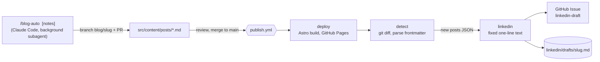

# Aqeel Ryan: blog and publishing pipeline

A static [Astro](https://astro.build) blog on GitHub Pages. A Claude Code session reads one of my projects and writes a post in my voice (`/blog-auto`), then opens a pull request. Merging the PR deploys the post and opens a GitHub Issue with a one-line LinkedIn announcement to post by hand. No external LLM API is used, and nothing is ever posted to LinkedIn automatically.

## Architecture



| Piece | Where | What it does |
|---|---|---|
| Site | `src/`, `astro.config.mjs` | Astro 7, static output, drafts filtered in one helper (`src/lib/posts.ts`) |
| Site URL | `site.config.json` | The single source of the site URL. Canonical URLs, RSS, OG tags and the Python scripts all read it |
| Auto-post skill | `skills/blog-auto/` | Claude Code skill `/blog-auto` (copy of `~/.claude/skills/blog-auto/`) |
| Draft skill | `skills/blog-draft/` | Claude Code skill `/blog-draft`, the interactive version that only saves a draft |
| New-post detection | `scripts/detect_new_posts.py` | A post is new if it was added with `draft: false`, or flipped from `draft: true` to `false`. Edits to published posts are ignored |
| LinkedIn text | `scripts/linkedin_drafts.py` | Writes `I posted a new blog today, check it out -> <link>` to `linkedin/drafts/` and opens an Issue. No LLM |
| Voice guide | `linkedin/voice.md` | Style input for `/blog-auto` |
| Workflows | `.github/workflows/publish.yml`, `ci.yml` | Publish on push to `main`. Tests and build on PRs |

The slug of `src/content/posts/2026-11-17-my-post.md` is `my-post`, and its URL is `<site>/posts/my-post/`. The same rule is implemented in `src/lib/urls.ts` and `scripts/posts.py`, and a test keeps them in step.

## One-time setup

1. **Create the repo and push.** The repo must be named `Aqeel-Ryan.github.io` so the site is served at `https://aqeel-ryan.github.io` with no base path. If you change the name or use a custom domain, edit `siteUrl` in `site.config.json` (nothing else).
2. **Enable Pages:** Settings, Pages, Source: **GitHub Actions**.
3. **Branch protection:** leave `main` unprotected, or allow `github-actions[bot]` to push. The bot commits `linkedin/drafts/` directly to `main` with `[skip ci]`.
4. **Edit `linkedin/voice.md`** so the posts sound like you, and fill in `src/pages/about.astro` (it is a stub).
5. **Install the skills** if they are not already in `~/.claude/skills/` (copy `skills/blog-auto/` and `skills/blog-draft/` there). The first run asks for the path of this repo. `gh` must be logged in.

No secrets or variables are needed. If an old `DEEPSEEK_API_KEY`, `DEEPSEEK_MODEL`, `DEVTO_API_KEY`, `HASHNODE_TOKEN`, `HASHNODE_PUBLICATION_ID` or `CROSSPOST_ENABLED` is still set under Settings, Secrets and variables, Actions, delete it.

### Local development

```bash
# Node >= 22.23.4 is required by Astro 7 (see .nvmrc)
npm ci
npm run dev           # http://localhost:4321
npm run check && npm run build

poetry install --no-root
poetry run pytest -q
```

## Day-to-day workflow

1. In any Claude Code session, run `/blog-auto <project path> [style or extra requirements]`, for example `/blog-auto ~/work/NEU/SPRING_26/rag-evals "plain tone, focus on the design tradeoffs"`. It runs in a background subagent, so you can keep working.
2. When it finishes you get a pull request on branch `blog/<slug>`. If it contains `TODO(verify)` markers it is a draft PR; resolve them and check each number against the project.
3. Merge the PR. The site deploys and a `LinkedIn post: <title>` Issue is assigned to you. Copy the text into LinkedIn at the suggested time.

For a draft you write yourself, use `/blog-draft`, edit the file, set `draft: false` and push to `main`.

Frontmatter reference (`src/content.config.ts`):

```yaml
title: "..."
description: "one sentence, max 300 chars"
date: 2026-11-17
tags: [rag, evals]
draft: true
linkedin: true            # false skips the LinkedIn text
cover: /images/x.png      # optional
project_repo: https://github.com/you/repo   # optional
# canonical_url is never written by hand: it is derived from site.config.json
```

### Regenerating the LinkedIn text

Actions, **Publish**, Run workflow, enter the post `slug`. Only the LinkedIn job runs; it overwrites `linkedin/drafts/<slug>.md` and opens a new Issue.

### Dry run

```bash
poetry run python -m scripts.linkedin_drafts --slug sample-pipeline-dry-run --dry-run
```

## How the guarantees work

- **Drafts never publish.** `getPublishedPosts()` filters `draft: true` for every page, tag, feed and sitemap entry. CI also fails if a draft slug appears in `dist/`.
- **`/blog-auto` never pushes to `main`.** It works in a separate git worktree on a `blog/<slug>` branch and opens a PR. Merging is the publish step.
- **Existing LinkedIn drafts are kept.** If `linkedin/drafts/<slug>.md` exists, a re-run skips it unless you regenerate it with `--slug`.
- **Actions are pinned to full commit SHAs** (a CI job enforces it).

## Troubleshooting

| Symptom | Likely cause and fix |
|---|---|
| Deploy job fails at `deploy-pages` | Pages source is not set to *GitHub Actions* (setup step 2) |
| Nothing happened after a push | The push touched no path in `publish.yml`'s `paths:` filter (for example only README or scripts), or the commit message contains `[skip ci]` |
| Site deployed but no Issue | The post is not *new* (it was already `draft: false`, or only edited), or `linkedin: false`. The job log of `detect` prints the JSON it found |
| Drafts commit fails to push | `main` is protected, or runs raced. Allow the bot to push, or add the files by hand |
| `npm ci` fails on Node version | Astro 7 needs Node >= 22.23.4; use the version in `.nvmrc` |
| `/blog-auto` or `/blog-draft` writes to the wrong repo | Edit `blog_repo` in `~/.claude/skills/blog-draft/config.json` (both skills read it) |

## Tests

`poetry run pytest -q` covers new-post detection (added, draft to published, edits ignored, first commit, bad inputs), frontmatter validation, and the LinkedIn text step (fixed text, skip cases, overwrite with `--slug`). On pull requests, `ci.yml` runs the tests, `astro check`, a build with a draft-leak check, and the SHA-pinning check.
