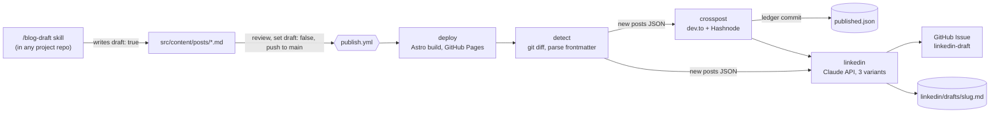

# Aqeel Ryan: blog and publishing pipeline

A static [Astro](https://astro.build) blog on GitHub Pages. Pushing a post with `draft: false` deploys it, cross-posts it to dev.to and Hashnode (canonical URL pointing here), and opens a GitHub Issue with three LinkedIn drafts to post by hand. Nothing is ever posted to LinkedIn automatically.

## Architecture



| Piece | Where | What it does |
|---|---|---|
| Site | `src/`, `astro.config.mjs` | Astro 7, static output, drafts filtered in one helper (`src/lib/posts.ts`) |
| Site URL | `site.config.json` | The single source of the site URL. Canonical URLs, RSS, OG tags and the Python scripts all read it |
| Draft skill | `skills/blog-draft/` | Claude Code skill `/blog-draft` (copy of `~/.claude/skills/blog-draft/`) |
| New-post detection | `scripts/detect_new_posts.py` | A post is new if it was added with `draft: false`, or flipped from `draft: true` to `false`. Edits to published posts are ignored |
| Cross-posting | `scripts/crosspost.py` | Direct dev.to and Hashnode API clients (crier was evaluated and rejected, see below) |
| Ledger | `published.json` | `slug -> platform -> {id, url, published_at}`. Checked before every publish, so nothing posts twice |
| LinkedIn drafts | `scripts/linkedin_drafts.py`, `linkedin/voice.md` | 3 validated variants per post, saved to `linkedin/drafts/` and opened as an Issue |
| Workflows | `.github/workflows/publish.yml`, `ci.yml` | Publish on push to `main`. Tests and build on PRs |

The slug of `src/content/posts/2026-11-17-my-post.md` is `my-post`, and its URL is `<site>/posts/my-post/`. The same rule is implemented in `src/lib/urls.ts` and `scripts/posts.py`, and a test keeps them in step.

### Why not crier?

[crier](https://pypi.org/project/crier/) 2.1.1 was evaluated first. It keeps publication state in a SQLite registry instead of a JSON ledger, expects `canonical_url` in the frontmatter (here it is derived), and bundles 15 platforms plus MCP and LLM features to publish two API calls. The two small clients in `scripts/crosspost.py` are easier to test and keep the ledger format under control.

## One-time setup

1. **Create the repo and push.** The repo must be named `Aqeel-Ryan.github.io` so the site is served at `https://aqeel-ryan.github.io` with no base path. If you change the name or use a custom domain, edit `siteUrl` in `site.config.json` (nothing else).
2. **Enable Pages:** Settings, Pages, Source: **GitHub Actions**.
3. **Branch protection:** leave `main` unprotected, or allow `github-actions[bot]` to push. The bot commits `published.json` and `linkedin/drafts/` directly to `main` with `[skip ci]`.
4. **Secrets** (Settings, Secrets and variables, Actions, *Secrets*):

   | Secret | Where to get it |
   |---|---|
   | `ANTHROPIC_API_KEY` | console.anthropic.com |
   | `DEVTO_API_KEY` | dev.to, Settings, Extensions, Generate API key |
   | `HASHNODE_TOKEN` | hashnode.com/settings/developer |
   | `HASHNODE_PUBLICATION_ID` | your publication's ID (Hashnode dashboard, or the `me { publications }` GraphQL query) |

5. **Variables** (same page, *Variables* tab):

   | Variable | Value |
   |---|---|
   | `CROSSPOST_ENABLED` | `true` to cross-post, anything else (or unset) to turn it off |
   | `ANTHROPIC_MODEL` | optional; defaults to `claude-sonnet-5-5` |

6. **Edit `linkedin/voice.md`** so the drafts sound like you, and fill in `src/pages/about.astro` (it is a stub).
7. **Install the skill** if it is not already at `~/.claude/skills/blog-draft/` (copy `skills/blog-draft/` there). The first `/blog-draft` run asks for the path of this repo.

### Local development

```bash
# Node >= 22.23.4 is required by Astro 7 (see .nvmrc)
npm ci
npm run dev           # http://localhost:4321
npm run check && npm run build

poetry install --no-root
poetry run pytest -q
```

## Day-to-day workflow

1. In a project repo, run `/blog-draft`. Answer the two questions (angle, off-limits). The draft lands in `src/content/posts/` with `draft: true`.
2. Edit the draft, resolve every `TODO(verify)`, and check each number against the project.
3. Set `draft: false` and push to `main`.
4. Wait a few minutes. The site is live, the post is on dev.to and Hashnode, and a `LinkedIn drafts: <title>` Issue is assigned to you. Pick a variant, edit it and post it by hand at the suggested time.

Frontmatter reference (`src/content.config.ts`):

```yaml
title: "..."
description: "one sentence, max 300 chars"
date: 2026-11-17
tags: [rag, evals]        # dev.to keeps the first 4 (alphanumeric only), Hashnode the first 5
draft: true
linkedin: true            # false skips the LinkedIn drafts
cover: /images/x.png      # optional
project_repo: https://github.com/you/repo   # optional
# canonical_url is never written by hand: it is derived from site.config.json
```

### Regenerating LinkedIn drafts

Actions, **Publish**, Run workflow, enter the post `slug`. Only the draft job runs; it overwrites `linkedin/drafts/<slug>.md` and opens a new Issue.

### Dry runs

```bash
# What would be cross-posted (no network, no ledger writes):
poetry run python -m scripts.crosspost --dry-run \
  --posts '[{"path":"src/content/posts/2026-11-17-sample-pipeline-dry-run.md"}]'
# What would be sent to the model (no API call):
poetry run python -m scripts.linkedin_drafts --slug sample-pipeline-dry-run --dry-run
```

For an end-to-end rehearsal, copy the sample post, set `draft: false`, and push to a scratch branch or fork with its own secrets.

## How the guarantees work

- **Drafts never publish.** `getPublishedPosts()` filters `draft: true` for every page, tag, feed and sitemap entry. CI also fails if a draft slug appears in `dist/`.
- **No duplicates.** Every (slug, platform) pair is looked up in `published.json` before posting and written immediately after success. Re-running the workflow, or editing a published post, posts nothing new. Concurrent runs are serialized.
- **Ambiguous failures are never auto-retried.** Only HTTP 429 is retried. After a timeout or a 5xx the post may or may not exist on the platform, so the run fails loudly and says to check before re-running.
- **LinkedIn drafts are checked in code,** not just requested: 120-220 words, short paragraphs, at most 3 hashtags (last line only), at most 1 emoji, the post URL exactly once near the end, and no number that is not in the post. One retry with the reasons, then the job fails.
- **Secrets** come only from Actions secrets, are passed to the one step that needs them, and are scrubbed from error text.
- **Actions are pinned to full commit SHAs** (a CI job enforces it).

## Troubleshooting

| Symptom | Likely cause and fix |
|---|---|
| Deploy job fails at `deploy-pages` | Pages source is not set to *GitHub Actions* (setup step 2) |
| Nothing happened after a push | The push touched no path in `publish.yml`'s `paths:` filter (for example only README or scripts), or the commit message contains `[skip ci]` |
| Site deployed but no cross-post or Issue | The post is not *new* (it was already `draft: false`, or only edited). The job log of `detect` prints the JSON it found |
| `crosspost` job skipped | `CROSSPOST_ENABLED` is not exactly `true` |
| `::warning::no cross-post credentials configured` | The secrets are missing. dev.to needs `DEVTO_API_KEY`; Hashnode needs both `HASHNODE_TOKEN` and `HASHNODE_PUBLICATION_ID` |
| `dev.to returned 422` | Usually a title that already exists or a tag problem. Nothing was recorded, so fix the post (or publish by hand) and re-run |
| Post exists on a platform but is missing from `published.json` | A timeout after the request went through. Add the entry by hand (`id` and `url` from the platform), then re-run |
| Hashnode error about publication or tags | Check `HASHNODE_PUBLICATION_ID`; tag slugs must exist or be creatable on your publication |
| Ledger or drafts commit fails to push | `main` is protected, or runs raced. Allow the bot to push, or add the files by hand |
| LinkedIn job: `drafts still invalid` | The model broke a rule twice (the log lists which). Re-run from the Actions tab, or tighten `linkedin/voice.md`. A draft that rounds or spells out a number from the post can trip the number check |
| LinkedIn job: `declined to write this post` | A safety classifier declined. Re-run, or write the LinkedIn post by hand |
| `ANTHROPIC_API_KEY is not set` | Add the secret (setup step 4) |
| `npm ci` fails on Node version | Astro 7 needs Node >= 22.23.4; use the version in `.nvmrc` |
| `/blog-draft` writes to the wrong repo | Edit `blog_repo` in `~/.claude/skills/blog-draft/config.json` |

## Tests

`poetry run pytest -q` covers new-post detection (added, draft to published, edits ignored, first commit, bad inputs), ledger idempotency and cross-post behavior with HTTP mocked, frontmatter validation, and LinkedIn JSON parsing and rule validation with the Anthropic client mocked. On pull requests, `ci.yml` runs the tests, `astro check`, a build with a draft-leak check, and the SHA-pinning check.
